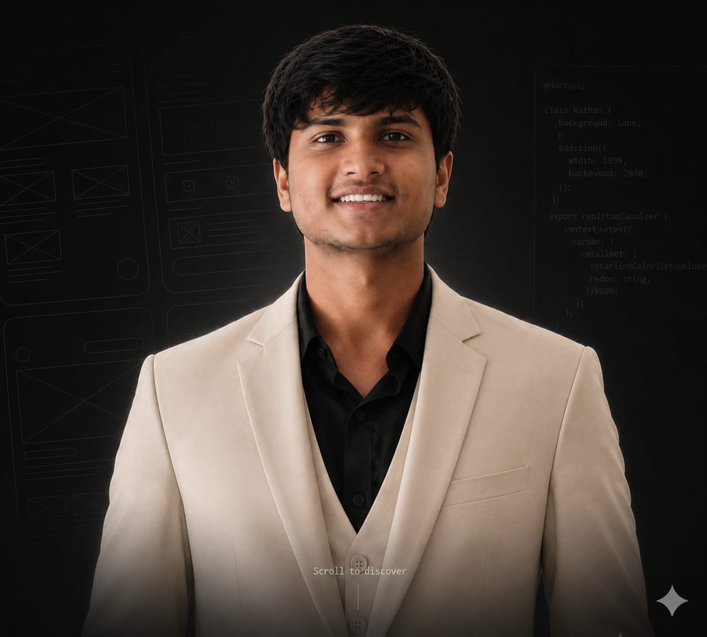

<div align="center">

# Mohammed Shoaeb Malik · Portfolio

**Personal portfolio of an AI, blockchain and full-stack developer: projects, progress log, expertise and contact in one animated page.**

[](https://nextjs.org)
[](https://react.dev)
[](https://www.typescriptlang.org)
[](https://tailwindcss.com)
[](https://www.framer.com/motion)
[](https://portfolio-nine-beta-b19t3dji0p.vercel.app)



</div>

---

## ✨ Overview

A single-page portfolio built with the Next.js App Router. It introduces Mohammed Shoaeb Malik and showcases AI systems, blockchain products and full-stack applications, with a light/dark theme and motion throughout.

## 🚀 Features

- **Hero with spotlight portrait** that switches between two photos, over an animated blueprint-grid background and a cursor glow.
- **Floating "About" section**, then numbered sections: Featured Projects, Progress Log, Area of Expertise and Contact.
- **Data-driven project showcase:** projects live in [`src/data/projects.ts`](src/data/projects.ts) with name, description, tech stack and optional live demo and GitHub links (or labels such as "Concept Build" / "Coming Soon").
- **Light and dark themes** via `next-themes` with a theme toggle.
- **SEO ready:** full metadata, Open Graph and Twitter cards, canonical URL, `robots.txt` and `sitemap.xml`.
- **Animations** with Framer Motion and icons from Lucide.

## 🧱 Tech Stack

- **Framework:** Next.js 15 (App Router), React 19, TypeScript
- **Styling:** Tailwind CSS 3
- **Motion:** Framer Motion
- **Theming:** next-themes
- **Icons:** lucide-react
- **Hosting:** Vercel

## 🗂️ Project Structure

```
.
├── public/                    # Portraits, favicon, robots.txt, sitemap.xml
├── src/
│   ├── app/
│   │   ├── layout.tsx         # Metadata, Open Graph, theme provider
│   │   ├── page.tsx           # Renders PortfolioHome
│   │   └── globals.css
│   ├── components/
│   │   ├── PortfolioHome.tsx  # All page sections
│   │   ├── ThemeToggle.tsx
│   │   └── providers.tsx
│   └── data/projects.ts       # Project list
└── tailwind.config.ts
```

## ⚡ Getting Started

```bash
npm install
npm run dev
# open http://localhost:3000
```

Production build:

```bash
npm run build
npm run start
```

### Add or edit a project

Append an entry to the `projects` array in `src/data/projects.ts`:

```ts
{
  name: "My Project",
  description: "One-line description.",
  techStack: "Next.js, TypeScript",
  demo: "https://...",          // optional
  github: "https://github.com/ShoaebMalik19/...", // optional
  demoLabel: "Coming Soon"      // optional, shown when there is no demo link
}
```

## 👤 Author

**Mohammed Shoaeb Malik** · AI & Full-Stack Developer, Bengaluru

[](https://github.com/ShoaebMalik19)
[](https://linkedin.com/in/shoaebmalik)
